<picture>
  <source media="(prefers-color-scheme: dark)" srcset="/docs/images/TOTEM_logo_dark.svg">
  <source media="(prefers-color-scheme: light)" srcset="/docs/images/TOTEM_logo_bright.svg">
  
</picture>

# ZMK CONFIG FOR THE TOTEM SPLIT KEYBOARD

[Here](https://github.com/GEIGEIGEIST/totem) you can find the hardware files and build guide.\
[Here](https://github.com/GEIGEIGEIST/qmk-config-totem) you can find the QMK config for the TOTEM.

TOTEM is a 38 key column-staggered split keyboard running [ZMK](https://zmk.dev/) or [QMK](https://docs.qmk.fm/). It's meant to be used with a SEEED XIAO BLE or RP2040.

This config is based on [GEIGEIGEIST/zmk-config-totem](https://github.com/GEIGEIGEIST/zmk-config-totem) via
[Conor-Burns/zmk-config-totem](https://github.com/Conor-Burns/zmk-config-totem). The dongle and ZMK Studio setup
follows [Conor-Burns/zmk-config-totem-dongle](https://github.com/Conor-Burns/zmk-config-totem-dongle).

## HOW TO USE

This config uses a **wireless USB dongle** as the central: both halves connect to the dongle, and the dongle
connects to the computer via USB. See [Wireless Dongle](#wireless-dongle) below.

- fork this repo
- `git clone` your repo, to create a local copy on your PC (you can use the [command line](https://www.atlassian.com/git/tutorials) or [github desktop](https://desktop.github.com/))
- adjust the `config/totem.keymap` file (find all the keycodes on [the zmk docs pages](https://zmk.dev/docs/codes/))
- `git push` your repo to your fork
- on the GitHub page of your fork navigate to "Actions"
- scroll down and unzip the `firmware.zip` archive that contains the latest firmware
- connect the dongle to your PC and double-tap the button on its case
- the dongle should now appear as a mass storage device (`XIAO-SENSE`)
- drag'n'drop the `totem_dongle-seeeduino_xiao_ble-zmk.uf2` file from the archive onto the storage device

Keymap changes only need the dongle reflashed. Flash the halves (`totem_left-…uf2` and `totem_right-…uf2`,
press reset twice on each half) only when setting up the dongle for the first time, after a ZMK update, or
after changing their hardware config.

## My Layout

## Wireless Dongle

The [dongle setup guide](./docs/dongle-setup/README.md) covers:

- what changes in the config compared to the left half acting as the central
- the first-time setup: settings reset and flashing all three devices
- [ZMK Studio](https://zmk.dev/docs/features/studio), which lets you edit the keymap live on the dongle
  (unlock key: *SYSTEM* layer, bottom-left outer key)
- troubleshooting and going back to "no dongle" mode

For a dongle with a display showing the battery level of both halves, see
[Prospector – Dongle with Display](./docs/prospector-dongle/README.md).
